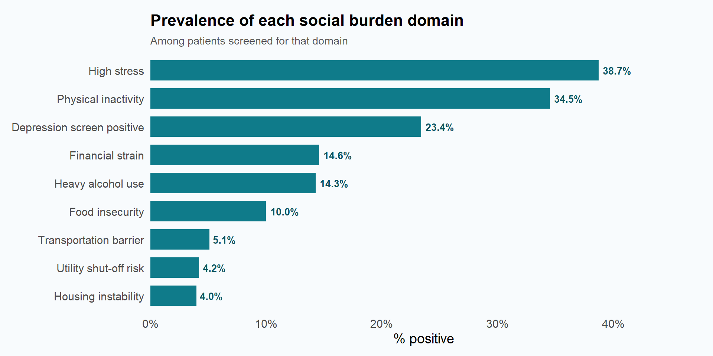
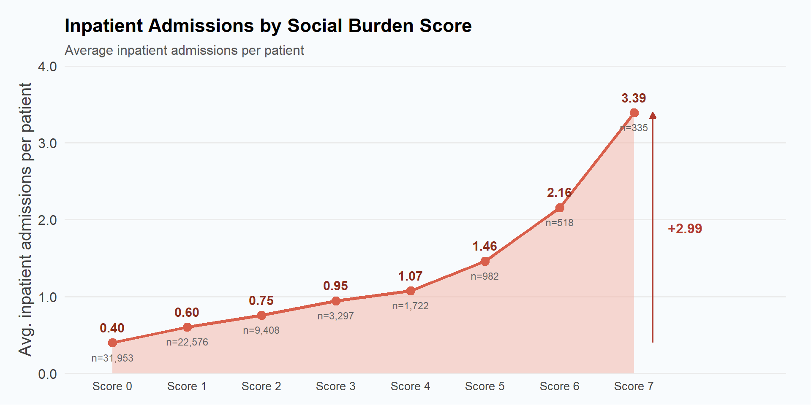
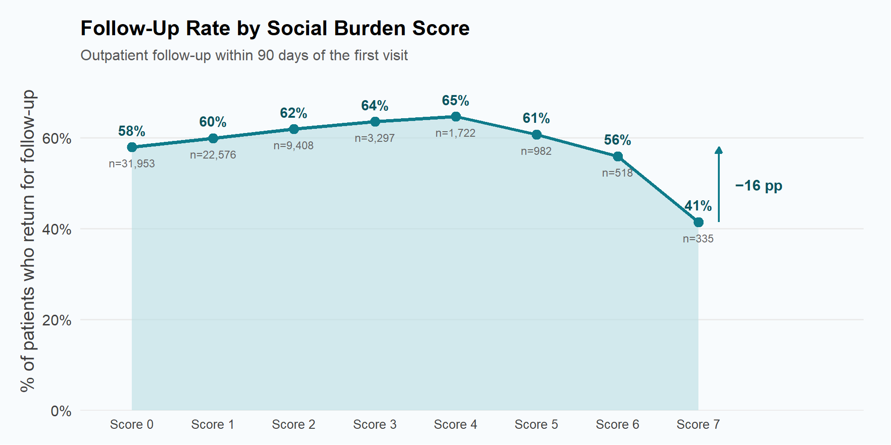
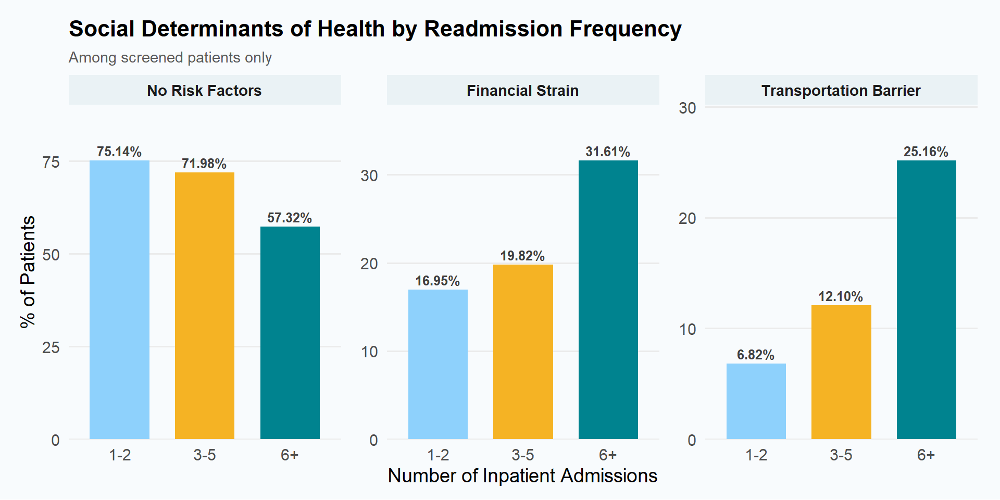
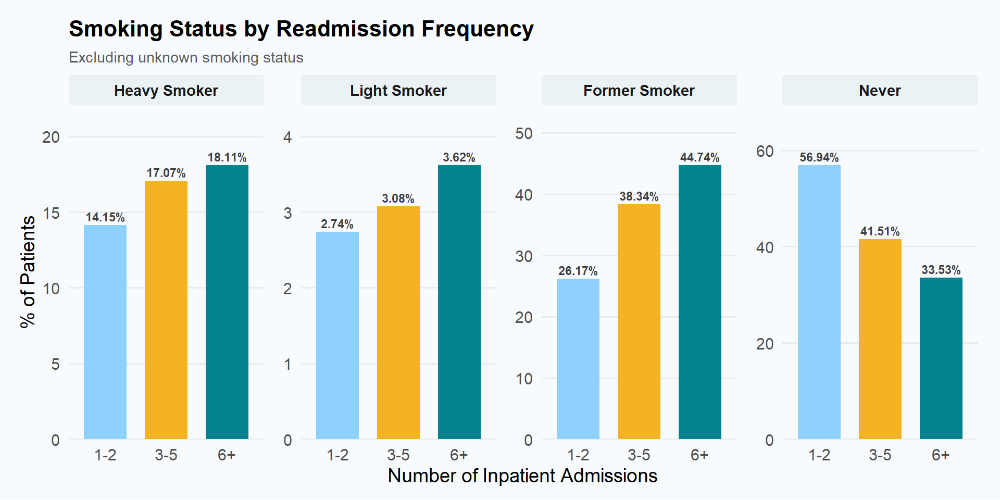
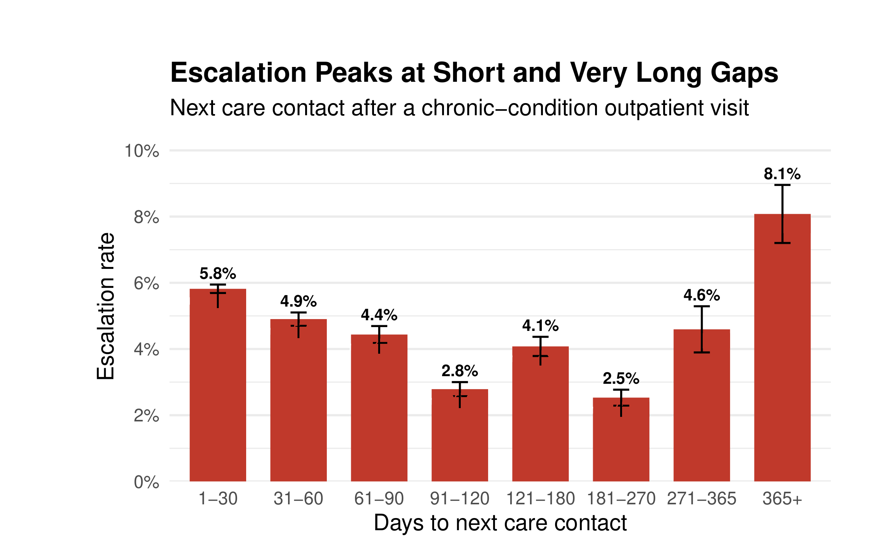
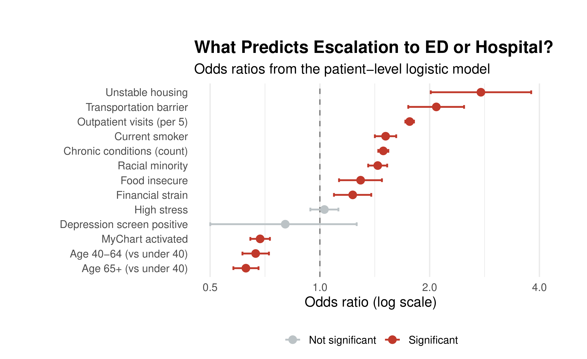
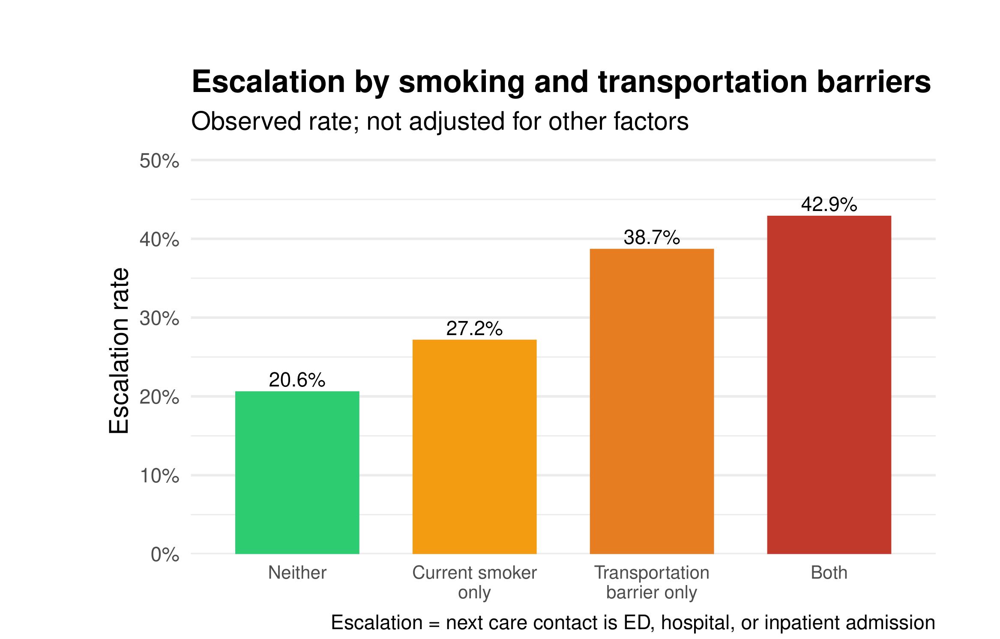

# Hospital Readmission Analysis

**Journey escalation, social burden, and readmission in a real hospital dataset.**

[](https://summerkirbs.github.io/Hospital-Readmission-Analysis/)
[](https://www.r-project.org/)
[](LICENSE)

This project analyzes social determinants of health, readmission frequency, and care-gap escalation in a large hospital dataset. It combines the original DataFest analysis with a stricter patient-level rebuild and a deeper look at what happens when chronic-care follow-up stops.

The public dashboard is a static site built from the same R code in this repository. No patient-level data is published.

## Features

- **Social Burden Score:** Counts positive domains across nine SDOH domains (food, transportation, housing, financial strain, utilities, stress, depression, alcohol, inactivity).
- **Patient-level cohort:** Keeps 70,791 patients with at least one usable survey answer, rather than counting questionnaire rows.
- **Readmission analysis:** Compares 1–2, 3–5, and 6+ inpatient admissions with social barriers and smoking status.
- **Follow-up analysis:** Measures face-to-face outpatient follow-up within 90 days of the first outpatient visit.
- **Care-gap escalation:** Follows 262,585 transitions after chronic-condition outpatient visits and identifies when the next contact is an ED visit or hospital admission.
- **Adjusted model:** Estimates patient-level odds ratios for social, demographic, and utilization predictors.
- **Compound risk:** Shows how smoking and transportation barriers combine.
- **Reproducible visuals:** Every chart on the dashboard is written by the R Markdown code in this repository.
- **Static dashboard:** A dependency-free GitHub Pages site with responsive charts and plain-language captions.

## Tech Stack

- **Language:** R
- **Data handling:** tidyverse, DuckDB, DBI
- **Modeling:** broom, base `glm`
- **Visualization:** ggplot2, scales
- **Reporting:** R Markdown, knitr, flexdashboard
- **Site:** HTML, CSS, GitHub Pages
- **License:** Apache 2.0

## Table of Contents

- [Overview](#overview)
- [Data](#data)
- [Methodology](#methodology)
- [Results](#results)
  - [Act I: Social burden and readmission](#act-i-social-burden-and-readmission)
  - [Act II: Care-gap escalation](#act-ii-care-gap-escalation)
- [Project Structure](#project-structure)
- [Reproducing the Analysis](#reproducing-the-analysis)
- [Dashboard](#dashboard)
- [Limitations](#limitations)
- [License](#license)
- [Important Links](#important-links)

## Overview

Two linked questions drive the project:

1. **Does social burden compound hospital use?** Patients with more social barriers have more inpatient admissions and less timely follow-up. The relationship is not a simple step: follow-up peaks in the middle of the score and then falls sharply for the highest-burden patients.
2. **What happens when chronic-care follow-up stops?** After a chronic-condition outpatient visit, the next care contact is sometimes an ED visit or hospital admission. Escalation risk is U-shaped: highest in the first month, lowest around 6–9 months, and highest again after a year.

The eight charts below tell both stories, with short takeaway-first captions and the definitions needed to read them.

## Data

The dataset is **private outside of the hackathon and is not included in this repository**. It spans multiple CSVs and hundreds of features across millions of rows; only the fields used in this analysis were selected and compiled into working tables. No patient-level records are published.

To rerun the analysis with authorized access, place these files in `DATA/`:

```text
DATA/
├── full_encounters.csv        # merged encounter table (care-gap analysis)
├── encounters.csv             # encounter-level table (dashboard cohort)
├── patients.csv               # demographics and smoking status
└── social_determinants.csv    # raw questionnaire responses
```

The scripts also look for the files in `../DATA/` and the working directory.

The data includes encounter dates from 2022 through 2025, inpatient and outpatient encounter flags, diagnosis groups, demographics, smoking status, and SDOH questionnaire responses. There is no data download link in this repository.

## Methodology

### Social Burden Score

The score adds one point per positive domain across nine SDOH domains. A patient enters the score only if they answered at least one domain; missing domains add zero, so the score is a lower bound on burden.

- **Food insecurity:** “Sometimes true” or “Often true” on either food question.
- **Transportation:** “Yes” to either transportation question.
- **Housing instability:** Homeless, no steady place to sleep in the past year, or 3+ moves.
- **Financial strain:** Paying for basics is somewhat hard, hard, or very hard, or unable to pay rent on time.
- **Utility shut-off risk:** Threatened shut-off or already shut off.
- **High stress:** “Rather much” or “Very much.”
- **Depression:** Edinburgh score ≥ 10 or PHQ-2 score ≥ 3.
- **Heavy alcohol use:** Drinking 2–3 times a week or more, or weekly binge drinking.
- **Physical inactivity:** Zero days of moderate exercise per week.

### Readmission and follow-up

- An **inpatient admission** is a distinct inpatient stay. Consecutive inpatient days count once.
- **Readmission bands** are 1–2, 3–5, and 6+ stays.
- **Follow-up** means a face-to-face outpatient visit within 90 days of the patient's first outpatient visit.
- The social score is cross-sectional: it uses the most recent positive answer available, not a time-varying exposure.

### Care-gap escalation

- An **anchor** is a face-to-face outpatient visit coded to a chronic condition.
- **Escalation** means the next care contact after the anchor is an ED visit, hospital admission, or inpatient stay.
- The **gap** is days from the anchor to that next contact. Same-day contacts and lab/imaging-only days are excluded.
- The patient-level outcome is whether a patient ever escalated.

### Model

A logistic regression estimates the odds of ever escalating, adjusting for smoking, MyChart activation, race, age, condition count, and visit count. Each SDOH variable is added separately because questionnaire coverage is incomplete, so the reported N varies by row. Odds ratios are descriptive associations, not causal effects. The compound-risk chart is unadjusted by design.

## Results

### Act I: Social burden and readmission

Across 70,791 patients with a usable SDOH survey, the average patient had 0.59 inpatient admissions, 60% returned for outpatient follow-up within 90 days, and 1.8% had 6+ admissions.



**01 · Stress and inactivity are the most common barriers. Housing and utility risk are the rarest.** Each bar is the share of patients screened for that domain who screen positive. Every domain has its own denominator and defined threshold, so read each bar within its own screened group. High stress reaches 38.7%, physical inactivity 34.5%, and housing instability 4.0%.



**02 · Every additional barrier travels with more inpatient use.** Points are the average number of distinct inpatient stays per patient in each score group. The line rises from 0.40 at score 0 to 3.39 at score 7, roughly an 8.5× increase.



**03 · Follow-up peaks in the middle, then falls sharply for the highest-burden patients.** The chart shows the share of patients with a face-to-face outpatient visit within 90 days of their first outpatient visit. Follow-up rises to 65% at score 4, then drops to 41% at score 7, a 16-point gap versus score 0. The score-7 group is small (n=335), so treat the final drop as directional.



**04 · The no-risk share falls as readmissions rise. Financial and transportation barriers rise.** Each panel shows the share of screened patients with that factor within each admission band, and panels use different y-axis scales. From 1–2 to 6+ admissions, the no-risk share falls 17.8 points, while financial strain and transportation barriers rise by 14.7 and 18.3 points.



**05 · Never-smokers fall from 56.9% to 33.5% as admissions rise. Former smokers rise from 26.2% to 44.7%.** Each panel shows the share of patients in a smoking group within each admission band, excluding unknown smoking status. Heavy and light smokers also grow, but from a smaller base.

### Act II: Care-gap escalation

The second analysis follows 90,836 chronic-condition patients through 262,585 outpatient-to-next-contact transitions. Escalation means the next contact is an ED visit, hospital admission, or inpatient stay, not another routine visit. The escalation rate is 5.0% per transition, and 14.6% of patients ever escalate.



**06 · Escalation is U-shaped: highest in the first month and after a year.** Each bar is the share of outpatient chronic-care anchors whose next care contact is an ED visit, hospital admission, or inpatient stay. Bars show 95% confidence intervals. Short gaps likely mix acute deterioration with routine follow-up; very long gaps are more consistent with disengagement. The rate is 5.8% at 1–30 days, falls to 2.5–2.8% around 6–9 months, then rises to 8.1% past a year.



**07 · Housing instability and transportation barriers are the strongest adjusted signals.** Odds ratios come from a patient-level logistic model. Values above 1 mean higher odds of ever escalating; values below 1 mean lower odds. Each social factor is added separately, so N varies by row. Unstable housing (OR 2.76), transportation barriers (2.09), and outpatient visit count (1.76 per 5 visits) lead the model, while MyChart activation (0.69) and older age (0.63–0.67) are associated with lower odds.



**08 · Risks compound: smoking plus a transportation barrier reaches 42.9% escalation.** These are observed escalation rates for four groups, not adjusted for other factors. The "both" group is small (n=198), so treat the exact gap as directional; the ordering is the useful signal. Rates are 20.6% for neither factor, 27.2% for smoking only, 38.7% for a transportation barrier only, and 42.9% for both.

### Two escalation rates

**5.0%** is the share of transitions that escalate; **14.6%** is the share of patients who ever escalate. They answer different questions. Use the first for the system view and the second for the patient view.

## Project Structure

```text
.
├── index.html                     # static GitHub Pages dashboard
├── assets/
│   ├── css/style.css              # dashboard styling
│   └── img/*.png                  # charts written by the R analysis
├── analysis/
│   ├── social_burden_dashboard.Rmd    # Act I: social burden and readmission
│   ├── agentic_datafest_patients.Rmd  # Act II: care-gap escalation
│   ├── dashboard_data.R               # cohort and SDOH table builder
│   └── dashboard.css                  # flexdashboard styling
├── reports/
│   ├── social_burden_dashboard.html   # rendered flexdashboard (generated)
│   └── agentic_datafest_patients.pdf  # rendered analysis report (generated)
├── scripts/
│   └── rebuild_site_figures.R     # rebuild all dashboard PNGs
├── .gitignore
├── .nojekyll
├── LICENSE
└── README.md
```

The files in `reports/` are generated artifacts kept for reference. The source of truth is the R Markdown and R code in `analysis/`.

## Reproducing the Analysis

### Requirements

- R (4.x recommended)
- The packages below
- Authorized access to the private source CSVs

```r
install.packages(c(
  "tidyverse", "broom", "DBI", "duckdb",
  "flexdashboard", "scales", "knitr", "rmarkdown"
))
```

### Rebuild the reports and dashboard figures

Place the private CSVs in `DATA/`, then run from the repository root:

```bash
Rscript scripts/rebuild_site_figures.R
```

This renders both R Markdown reports into `reports/` and writes the eight dashboard PNGs to `assets/img/`.

Individual reports can also be rendered directly:

```bash
Rscript -e 'rmarkdown::render("analysis/social_burden_dashboard.Rmd", output_file = "reports/social_burden_dashboard.html")'
Rscript -e 'rmarkdown::render("analysis/agentic_datafest_patients.Rmd", output_file = "reports/agentic_datafest_patients.pdf")'
```

The first render scans the encounter file once and caches the result in `analysis/cache/`. Delete `analysis/cache/dashboard_data.rds` to force a rebuild. Generated `analysis/cache/` and `analysis/figures/` folders are ignored by git.

## Dashboard

The dashboard is served by GitHub Pages from the repository root:

**https://summerkirbs.github.io/Hospital-Readmission-Analysis/**

It is plain HTML and CSS with one small progressive-enhancement script for the active navigation link. There are no external fonts, CDNs, or tracking scripts. `.nojekyll` disables Jekyll so the site is served as-is.

Every chart is reproducible from code:

- `analysis/social_burden_dashboard.Rmd` writes `domain-prevalence.png`, `admissions-by-score.png`, `followup-by-score.png`, `sdoh-by-readmission.png`, and `smoking-by-readmission.png`.
- `analysis/agentic_datafest_patients.Rmd` writes `escalation-by-gap.png`, `escalation-odds-ratios.png`, and `compound-risk.png`.
- `scripts/rebuild_site_figures.R` rebuilds all eight charts and both reports in one step.

## Limitations

- The social score is cross-sectional and depends on questionnaire coverage; it is not a time-varying exposure.
- The highest score group is small (n=335), so the final follow-up drop is directional.
- The “both risk factors” group in the compound chart is small (n=198).
- Odds ratios are adjusted associations, not causal effects. Unmeasured confounding remains.
- The data cannot be redistributed, so external readers cannot rerun the analysis without authorized access. The code and aggregate results are public.

## License

This project is licensed under the Apache License 2.0. See the [LICENSE](LICENSE) file for details.

## Important Links

- **Live Dashboard:** [summerkirbs.github.io/Hospital-Readmission-Analysis](https://summerkirbs.github.io/Hospital-Readmission-Analysis/)
- **Repository:** [SummerKirbs/Hospital-Readmission-Analysis](https://github.com/SummerKirbs/Hospital-Readmission-Analysis)
- **Full escalation report:** [reports/agentic_datafest_patients.pdf](reports/agentic_datafest_patients.pdf)
- **Rendered social-burden dashboard:** [reports/social_burden_dashboard.html](reports/social_burden_dashboard.html)
